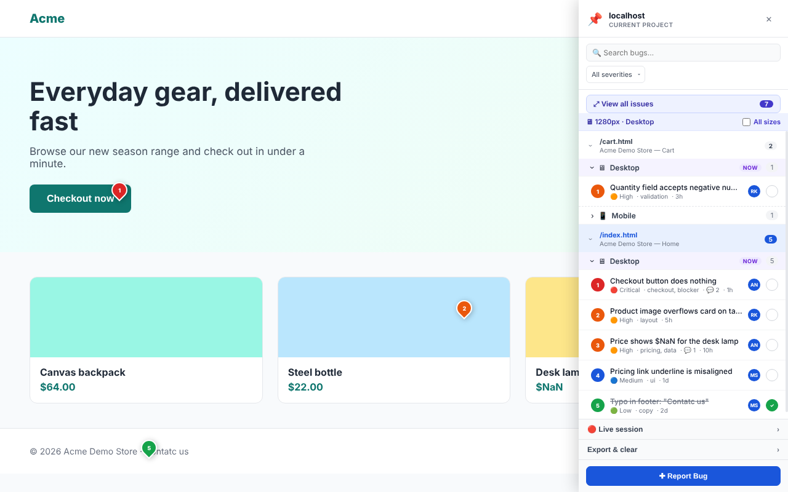
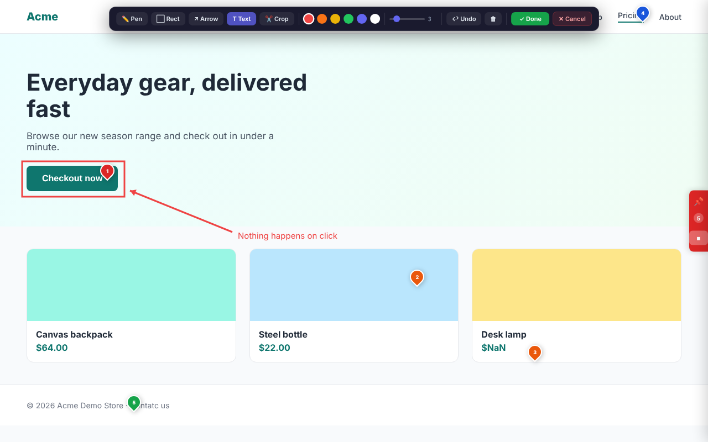
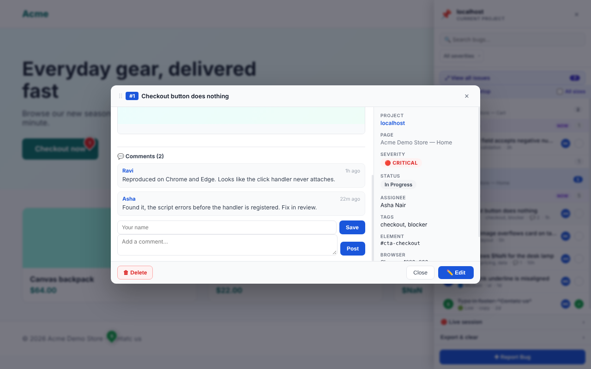
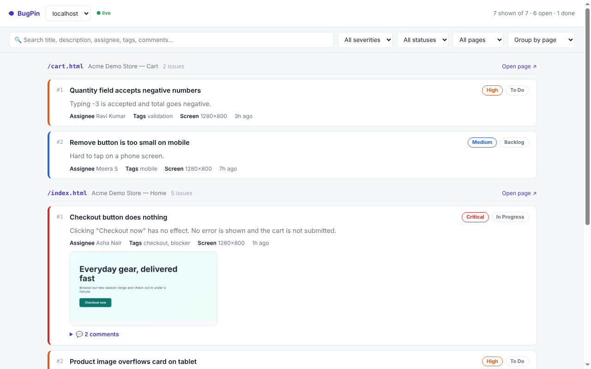
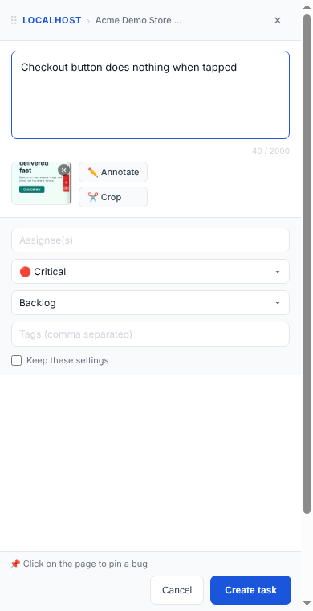
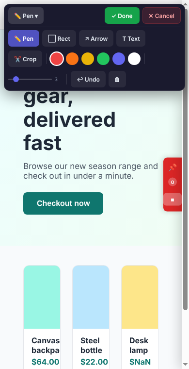

# BugPin WL1 — Live

A Chrome extension (Manifest V3) for **visual bug tracking directly on a web page**, with **live peer-to-peer sharing** between teammates — no server, no account, no cost.

Click any element on a page to pin a bug to it, describe it, attach an annotated screenshot, and discuss it in a comment thread. Start a live session and a teammate sees your bugs and comments appear in their browser in real time.

> Current version: **1.5.0**

## Screenshots

*Shown on a demo page with sample bugs.*

**Pins on the page, with the sidebar listing every bug**



**Annotate the screenshot: rectangle, arrow, text, crop and more**



**Bug details with a comment thread**



**View all issues in a full-size tab**



**Works on narrow screens too**

<p>
  
  &nbsp;&nbsp;
  
</p>

---

## Table of contents

- [Screenshots](#screenshots)
- [Features](#features)
- [Install](#install)
- [Quick start](#quick-start)
- [How it works](#how-it-works)
  - [Activating BugPin](#activating-bugpin)
  - [Reporting a bug](#reporting-a-bug)
  - [Annotating the screenshot](#annotating-the-screenshot)
  - [Pins and screen sizes](#pins-and-screen-sizes)
  - [The sidebar](#the-sidebar)
  - [Bug details and comments](#bug-details-and-comments)
  - [View all issues](#view-all-issues)
  - [Live sessions](#live-sessions)
  - [Export as document](#export-as-document)
  - [Clear all bugs](#clear-all-bugs)
- [Responsive and touch support](#responsive-and-touch-support)
- [Privacy and data](#privacy-and-data)
- [Permissions](#permissions)
- [Limitations](#limitations)
- [Troubleshooting](#troubleshooting)
- [Project structure](#project-structure)
- [Changelog](#changelog)
- [License](#license)

---

## Features

**Reporting**
- Click any element on a page to pin a bug to it (a numbered pin, coloured by severity)
- Form with description, assignee, severity (Critical / High / Medium / Low), status (Backlog / To Do / In Progress / Done) and tags
- Automatic screenshot of the page, with a built-in annotation editor: pen, rectangle, arrow, text, crop, six colours, adjustable stroke, undo and clear
- "Keep these settings" remembers severity, status, assignee and tags for the next bug
- Threaded comments on every bug, with a saved author name

**Pins**
- A numbered pin is placed where you click, coloured by severity
- Each bug records the element you clicked (shown in its details) and the screen size it was reported on
- Pins are tagged Mobile, Tablet or Desktop and shown only for the matching window width, with an "All sizes" override

**Live sharing (peer to peer)**
- One person hosts and shares a code; others join with it
- Bugs, edits, deletions and comments sync both ways in real time
- The host's share code is **stable**: the same code every time on the same site and browser
- A session **survives a page refresh or moving to another page on the same site**
- A guest who disconnects or closes the tab can rejoin and catch up on anything missed
- Bugs a guest receives are saved in their own browser and stay after the session ends
- Works with three or more people (the host relays between guests)

**Overview and sharing**
- **View all issues**: a full-size tab listing every issue with search, filters and sorting; updates by itself
- **Export as document**: a self-contained, printable HTML report (print it to PDF)
- **Clear all bugs** for this page or the whole site, with a confirmation

**Interface**
- Stays out of the way: nothing is shown on a page until you activate BugPin
- Responsive: the sidebar, bug form and annotation tools adapt to narrow windows and work with touch and pen

---

## Install

BugPin is installed from source as an unpacked extension. This works in Chrome and other Chromium browsers (Edge, Brave, Opera, Arc).

1. **Get the code**
   - Clone: `git clone https://github.com/Aswinellath/bugpin-wl1.git`
   - Or download the ZIP from GitHub (**Code → Download ZIP**) and unzip it.
2. Open **`chrome://extensions`** (Edge: `edge://extensions`).
3. Turn on **Developer mode** (top right).
4. Click **Load unpacked** and select the folder that contains `manifest.json`.
5. Optional: click the puzzle-piece icon in the toolbar and **pin** BugPin so its icon is always visible.

To update later: pull or re-download the code, then click the reload (circular arrow) button on the BugPin card in `chrome://extensions`, and refresh any open pages.

> Firefox is not tested for this version.

---

## Quick start

1. Open any website (`http` or `https`).
2. Click the **BugPin toolbar icon**. A small blue tab appears on the right edge of the page.
3. Click the **✚** button on that tab (or **Report Bug** in the sidebar) to start reporting.
4. Click the element that has the problem. A form opens.
5. Describe it, set the severity, and click **Create task**. A pin appears on the page.

---

## How it works

### Activating BugPin

- Click the **toolbar icon** to **activate** BugPin on the current tab. A floating tab appears on the right edge of the page and your pins are drawn.
- Click the toolbar icon again to **deactivate**: the tab and pins are hidden. Your bugs stay saved and come back when you activate again.
- BugPin does nothing on a page until you activate it, and activation is remembered for that tab until you close it.

The floating tab has three parts:

| Control | What it does |
| --- | --- |
| 📌 | Opens or closes the sidebar |
| Number | How many bugs are on this page |
| ✚ / ⏹ | Starts or stops **Report Bug** mode without opening the sidebar. The tab turns red while the mode is on. |

### Reporting a bug

1. Turn on Report Bug mode (the ✚ button on the tab, or **Report Bug** at the bottom of the sidebar). The cursor becomes a crosshair.
2. Click the element on the page. The page is captured and a form opens.
3. Fill in:
   - **Description** (up to 2000 characters)
   - **Assignee**, **Severity**, **Status**, **Tags** (comma separated)
   - **Keep these settings** to reuse severity, status, assignee and tags next time
4. Optionally **Annotate** or **Crop** the screenshot, or remove it.
5. Click **Create task**.

To stop reporting, click ⏹ on the tab, or **Stop reporting** in the sidebar.

### Annotating the screenshot

**Annotate** freezes the page as a still image and opens the drawing tools:

- **Pen**, **Rect**, **Arrow**, **Text** (type, then press Enter), **Crop** (drag a region)
- Six colours and a stroke-width slider
- **Undo** and **Clear**
- **Done** saves your markup; **Cancel** discards it

Your form fields are kept while you annotate. On narrow screens the tools fold into a compact **Tools** button; Done and Cancel stay visible.

### Pins and screen sizes

- Each pin is numbered and coloured by severity: red Critical, orange High, blue Medium, green Low.
- Click a pin to open that bug.
- Each bug remembers the screen size it was reported on: **Mobile** (up to 480px), **Tablet** (481–1024px) or **Desktop** (1025px and up). Only pins for the current size are shown.
- The sidebar shows your current window width and how many pins are hidden. Tick **All sizes** to show every pin.
- A pin stays at the position where it was placed on the page. If a site's layout changes a lot, a pin may no longer line up with the element it was reported on, so check the element shown in the bug's details.

### The sidebar

Open it with the 📌 button on the floating tab.

- **Search** by title, description or assignee, and **filter by severity**
- Bugs are grouped by **page**, then by **screen size**
- Each row shows its number, severity, tags, comment count and age, plus the assignee's initials
- The circle on the right marks a bug **done** (it is struck through)
- **View all issues** opens the full-size list in a new tab
- **Live session** and **Export & clear** panels at the bottom (one open at a time)
- **Report Bug** / **Stop reporting** button at the bottom

### Bug details and comments

Click a bug in the sidebar or a pin on the page to open its details, where you can **edit** or **delete** it.

Under the details there is a comment thread:
- The first time you comment you are asked for your **name** (required). It is saved in your browser.
- Comments are threaded, timestamped and show the author.
- Comments sync live to everyone in a live session, including an open detail window.

### View all issues

The **⤢ View all issues** button in the sidebar opens a full-size page in a new tab:

- Every issue for the site, grouped by page, with description, assignee, tags, screenshot (click to enlarge) and comments
- Search (title, description, assignee, tags, comments) and filters for severity, status and page
- Sort by page, newest first, or most severe first
- **Open page** link for each page
- Updates automatically when bugs change, including bugs arriving from a live session
- Read-only: make edits in the sidebar so live sync stays consistent

### Live sessions

Share bugs with a teammate in real time. Open the sidebar and expand **Live session**.

**Host**
1. Click **Start session (host)**.
2. Copy the **code** that appears and send it to your teammate.

**Guest**
1. Open the **same site** in your browser and activate BugPin.
2. Paste the code and click **Join**.

**What syncs**
- New bugs, edits, status changes, deletions and comments, both directions
- When someone connects (or reconnects), both sides exchange their bugs for the current page and merge them, so nothing is lost

**Good to know**
- The code is the same every time for the same site and browser, so you can share it once.
- The session **survives a refresh or moving to another page on the same site**: the host re-claims the same code, and a guest keeps retrying (for about 75 seconds) until it is back in.
- If a guest closes the tab, they can open the site again and rejoin while the host is still hosting.
- Bugs a guest receives are saved in their own browser and are kept after the session ends.
- Syncing is **per page**: both people need to be on the same page to see each other's bugs there.
- The session is remembered **per tab**. A new tab does not join automatically, and moving to a different website ends the session (bugs are saved per site).
- Press **Leave session** to end it for good; a later refresh will not rejoin.

### Export as document

In **Export & clear**, choose **This page** or **Whole site**, choose whether to include screenshots, and click **Export as document**. You get a single HTML file with a summary, every bug grouped by page, severity and status, screenshots and technical details. Open it in a browser and **print to PDF** to share it.

### Clear all bugs

In **Export & clear**, pick **This page** or **Whole site** and click **Clear all bugs**. A confirmation names exactly what will be deleted. In a live session the deletions are sent to connected people as well. This cannot be undone.

---

## Responsive and touch support

- Below about 920px wide the annotation toolbar becomes a compact bar with a **Tools** button; picking a tool folds it away so the canvas has room.
- Below 640px the bug form fills the window and its two columns stack and scroll.
- The sidebar never exceeds the window width.
- Drawing works with mouse, touch and pen.

Note: Chrome on Android does not support extensions, so this means narrow desktop windows, tablets and touch-screen laptops, not phone browsers.

---

## Privacy and data

- **Everything is stored locally** in your browser (`chrome.storage.local`), including screenshots. There is no BugPin server and no account.
- **Live sessions are peer to peer.** Bug data goes directly between the browsers in the session.
- To *connect* two browsers, BugPin uses the free public **PeerJS** broker for the initial handshake and free public **STUN** servers (Google, Twilio) to find a route between them. These see connection metadata (such as IP addresses and session IDs) but not your bugs or screenshots.
- Anyone who has your session code can join your session while it is running, so share it only with people you trust.

---

## Permissions

| Permission | Why |
| --- | --- |
| `storage` | Save bugs, settings and your comment name locally |
| `activeTab` | Capture a screenshot of the page you are reporting on |
| `scripting` | Inject BugPin into a tab that was open before the extension was installed or reloaded |
| `tabs` | Open the "View all issues" tab and reuse it if already open |
| Access to all sites (`<all_urls>`) | Run on whichever site you choose to report bugs on. BugPin only draws on a page after you activate it. |

---

## Limitations

- Works on `http` and `https` pages only. It cannot run on `chrome://` pages, the Chrome Web Store, or other browser-internal pages. For local `file://` pages, enable **Allow access to file URLs** on the extension's details page.
- Live sharing uses STUN only (no TURN relay), so some strict corporate or mobile networks may block a direct connection.
- Live sync is per page, and a session is tied to one tab and one site (see [Live sessions](#live-sessions)).
- Pins are placed at a fixed position on the page and do not move with their element, so they can drift from it if a site's layout changes or on a very different screen size.
- Bugs are saved per browser. Clearing the extension's data or removing the extension deletes them, so export a document if you need a copy.

---

## Troubleshooting

| Problem | What to try |
| --- | --- |
| Nothing happens when I click the icon | Reload the page, then click the icon again. It does not run on browser-internal pages. |
| I can't see my pins | BugPin must be activated on this tab. Check the **All sizes** box in case they belong to another screen size. |
| Screenshot is blank or missing | The page must be visible in the active tab when you click. Try again with the tab in front. |
| "Could not reach the host directly" | Both people need internet access and the host's tab open. Strict networks can block direct connections. |
| "No active session with that code" | Check the code, and make sure the host has started the session and is online. |
| Guest does not see the host's bugs | Both people must be on the **same page** of the site. |
| Changes to the extension code don't show | Click reload on the BugPin card in `chrome://extensions`, then refresh the page. |

---

## Project structure

```
manifest.json          Extension manifest (MV3)
icons/                 Toolbar and store icons
src/
  background.js        Service worker: screenshots, toolbar click, opens the issues tab
  content.js           Runs on pages: pins, tab, annotation tools, live sync engine
  content.css          Styles for everything drawn on the page
  sidebar.html/.js/.css  Sidebar UI (bug tree, live panel, export, clear)
  modal.html/.js/.css    Bug form and bug detail / comments window
  viewer.html/.js/.css   "View all issues" full-page list
  peerjs.min.js        PeerJS (bundled) for WebRTC connections
docs/screenshots/      Images used in this README
```

---

## Changelog

**1.5.0**
- Start/stop Report Bug mode from the floating tab; sidebar button shows the current state

**1.4.0**
- Responsive annotation tools, bug form and sidebar; touch and pen drawing
- Live sessions survive refresh and same-site navigation, with automatic rejoin

**1.3.0**
- "View all issues" full-page list
- Removed `.bugpin` file export/import

**1.2.0**
- Threaded, named, live-synced comments

**1.1.0**
- Clear all bugs; pins and tab only appear after activation

**1.0.0**
- Live peer-to-peer sync (WebRTC / PeerJS) on top of BugPin v21.2

---

## License

BugPin WL1 is released under the [MIT License](LICENSE). You are free to use, modify and redistribute it, as long as the copyright notice is kept.

It bundles [PeerJS](https://peerjs.com) (`src/peerjs.min.js`), which is also MIT-licensed and remains under its own license.
